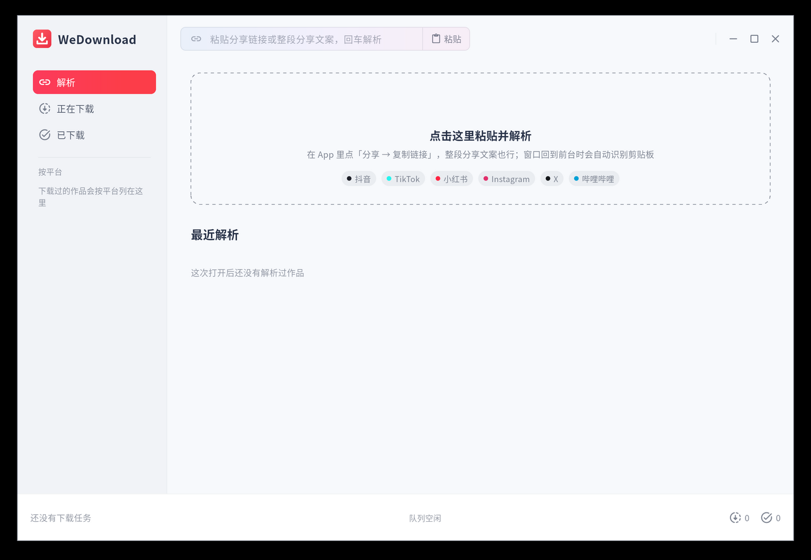

<div align="center">


# WeDownload

**粘贴分享链接，一键下载无水印的短视频和图文**

Rust 内核 × Flutter 界面 · Linux / Windows / macOS · 无服务器，所有解析都在本机完成



</div>

## 支持的平台

| 平台 | 内容 | 解析方式 | 说明 |
|---|---|---|---|
| 抖音 | 视频（最高 1080p，H.264 / H.265）、图文、实况图、背景音乐 | 本机浏览器 | 无水印 |
| TikTok | 视频（最高 1080p）、图文、背景音乐 | 直连 | |
| 小红书 | 视频、图文（原图 PNG）、实况图 | 本机浏览器 | 链接需带 `xsec_token`（App 内「分享 → 复制链接」即可） |
| Instagram | Reels、帖子、多图帖 | 本机浏览器 | 公开内容 |
| X（Twitter） | 视频、GIF、图片（原图） | 直连 | 公开推文 |
| 哔哩哔哩 | 视频（未登录常见 720p）、分 P | 直连 | 海外出口 IP 会被拒绝 |
| 其他网站 | 直链文件、页面里的视频 | yt-dlp（若已安装）/ 页面嗅探 | |

**暂不支持**：微信视频号（需要截获微信客户端流量，本项目不做）。

### 为什么要用到本机浏览器

抖音、小红书、Instagram 的网页接口都要页面脚本现算签名和设备指纹，单纯发 HTTP 请求拿不到数据。WeDownload 会在后台（无窗口）启动本机已安装的 **Chrome / Edge / Chromium / Brave**，打开作品页，读取页面自己收到的数据，然后关闭标签页。

- Windows 自带 Edge，开箱即用；Linux / macOS 需要装有任意一款 Chromium 系浏览器。
- 解析用的是独立的浏览器档案（在数据目录下），不会碰你平时的浏览器资料。
- 抖音第一次解析会慢一些（要先建立会话），之后通常 5–15 秒。
- 遇到验证时，在设置里打开「显示解析浏览器窗口」，在弹出的窗口里处理一次即可。

## 使用

1. 在 App 里点「分享 → 复制链接」（整段分享文案也可以）；
2. 回到 WeDownload，窗口获得焦点时会自动识别剪贴板并解析；也可以手动粘贴；
3. 勾选要下载的条目、选择清晰度，点下载。

默认保存到 `~/Downloads/WeDownload/<平台>/`，可以在设置里改。

## 命令行

```bash
wedl "7.94 复制打开抖音，看看【…】 https://v.douyin.com/xxxx/"     # 下载最佳画质
wedl --info <链接>                                              # 只看解析结果
wedl --json <链接>                                              # 输出完整 JSON
wedl -o ~/Videos <链接>                                          # 指定目录
```

## 从源码构建

需要 Rust（stable）与 Flutter 3.47+；Linux 另需 `libgtk-3-dev ninja-build clang cmake pkg-config`。

```bash
cargo build --release -p wd-cli          # 命令行版：target/release/wedl
cd app && flutter build linux --release  # 桌面版（windows / macos 同理）
```

改了 `app/rust/src/api` 下的接口后，运行 `flutter_rust_bridge_codegen generate`（2.13.0）重新生成 Dart 绑定。

开发用环境变量：

- `WEDOWNLOAD_DATA_DIR`：使用独立的数据目录；
- `WEDOWNLOAD_AUTOTEST=<链接>`：启动后自动解析并下载，用于界面检查；
- `WD_BROWSER=<路径>`：指定解析用的浏览器。

## 结构

```
crates/wd-core     内核：链接识别、各平台解析器、浏览器后端（DevTools 协议）、分段并行下载、任务队列
crates/wd-cli      命令行 wedl
app/               Flutter 桌面应用；app/rust 是 flutter_rust_bridge 桥接层
```

## 声明

仅供个人保存自己有权保存的内容。请遵守各平台的用户协议与版权法规，不要用于批量抓取或再分发。

## 许可

MIT
